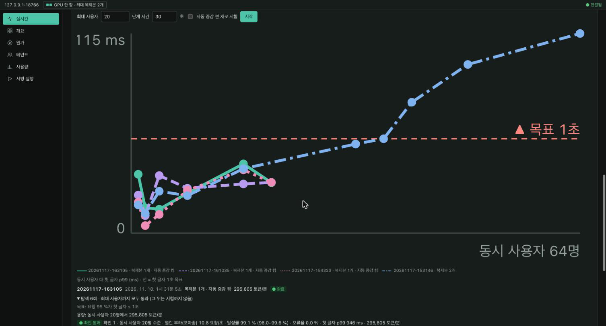
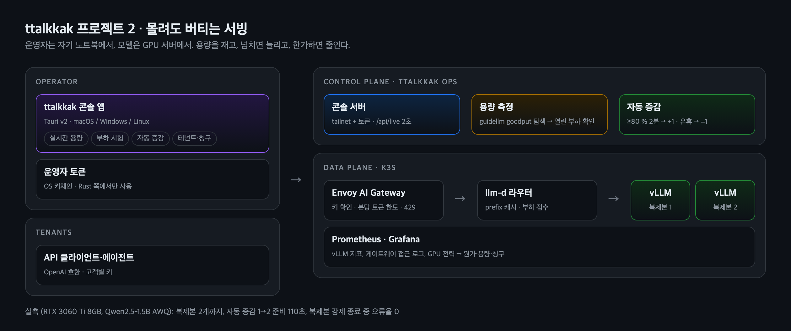
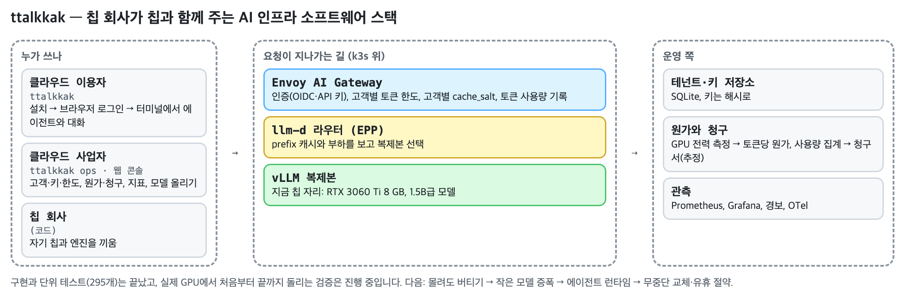

<p align="center">
  <picture>
    <source media="(prefers-color-scheme: dark)" srcset="docs/images/logo_dark.png">
    
  </picture>
</p>

<p align="center">
GPU 서버로 ChatGPT 같은 AI API를 팔려는 회사를 위한 운영 도구입니다.<br>
모델을 띄우고, 손님마다 사용량을 세고, 사람이 몰리면 서버를 늘려 줍니다.
</p>

<p align="center">
<a href="#어떤-문제를-푸나"><b>소개</b></a> ·
<a href="#데스크톱-앱-내려받기"><b>앱 내려받기</b></a> ·
<a href="docs/results/project2/summary.md"><b>실측 결과</b></a> ·
<a href="https://thisish3.tistory.com/104"><b>개발 일지</b></a> ·
<a href="docs/KNOWN_ISSUES.md"><b>알려진 문제</b></a>
</p>

<p align="center"></p>

## 어떤 문제를 푸나

GPU 서버에 오픈소스 LLM을 올려 API로 팔려면 모델을 띄운 다음이 더 바쁩니다. 서버가 동시에 몇 명까지 받는지 알아야 손님을 받을 수 있고, 손님이 생기면 각자 쓴 만큼 세어 청구해야 합니다. 점심시간처럼 요청이 몰리면 모델을 하나 더 띄워야 하고요. 보통은 운영자가 터미널과 대시보드를 오가며 이걸 챙깁니다.

ttalkkak은 이 일을 앱 하나에서 하도록 만든 프로젝트입니다. 노트북에서 앱을 열어 서버에 접속하면 서버가 지금 몇 % 찼는지 보이고, 넘치는 상태가 이어지면 모델이 하나 더 뜹니다.

## 앱 화면

첫 화면은 서버 상태입니다. 가운데 원 그래프의 100 %는 앱에서 부하 시험을 돌려 잰 용량입니다. 부하 시험은 가상의 손님을 1명, 2명, 4명으로 늘려 가며 응답이 1초를 넘기 시작하는 지점을 찾고, 그 속도로 요청을 한 번 더 보내 버티는지 확인한 뒤에 용량으로 저장합니다.

<p align="center"></p>

그 밖에 손님별 API 키와 분당 한도, 사용량과 예상 청구 금액, 자동으로 늘리고 줄인 기록(언제, 왜)을 볼 수 있고, 새 모델을 올리기 전에 이 서버에서 제대로 도는지도 확인할 수 있습니다. 앱은 macOS, Windows, Linux용이 있고, 서버 접속 토큰은 운영체제 키체인에만 저장합니다.

## 집에서 돌려 본 결과

RTX 3060 Ti(8GB) 한 장으로 해 봤습니다. 숫자의 근거는 [docs/results/project2](docs/results/project2/summary.md)에 있습니다.

| 해 본 것 | 결과 |
|---|---|
| GPU 한 장에 모델 몇 개 | 1.5B 모델 그대로는 1개, 4비트로 줄이면 2개 |
| 모델 1개 vs 2개 | 처리량은 거의 같았습니다. 다만 손님이 끊임없이 들어오는 상황에서 1초 안에 답한 인원이 16명에서 36명으로 늘었습니다 |
| 자동 증감 | 사용률 110 %가 2분 넘게 이어지자 모델을 하나 더 띄웠고(준비까지 110초), 한가해지자 다시 내렸습니다. 실패한 요청은 0건 |
| 모델 하나 강제 종료 | 다시 뜨기까지 144초, 그동안 실패한 요청 0건 |
| 손님별 한도 | 한도를 넘긴 요청은 거절됐고, 앱의 사용량이 서버 로그와 일치 |

## 구조

<p align="center"></p>

쿠버네티스(k3s) 위에 vLLM을 띄우고, 앞단에 요청을 나눠 주는 llm-d와 키·한도를 검사하는 Envoy AI Gateway를 뒀습니다. 부하 시험에는 vLLM 프로젝트의 guidellm을, 앱에는 Tauri를 썼습니다. 측정 방법을 이렇게 정한 이유는 블로그에 따로 적었습니다([부하 시험](https://thisish3.tistory.com/103), [서빙 지표](https://thisish3.tistory.com/99), [개발 일지 #3](https://thisish3.tistory.com/104)).

이 프로젝트는 추론 칩 회사의 입장에서 시작했습니다. NVIDIA는 GPU와 함께 NIM, Dynamo 같은 소프트웨어를 내놓는데, 다른 칩 회사가 같은 걸 하려면 무엇이 필요한지 직접 만들어 보고 싶었습니다. 그래서 칩마다 달라지는 값은 코드 대신 설정 파일(`chips/*.yaml`)로 빼 두었습니다. 손님 쪽에서는 `ttalkkak` 명령으로 터미널에서 에이전트와 대화할 수 있고, 매 턴 쓴 토큰과 예상 요금이 표시됩니다.

<p align="center"></p>

## 기능과 상태

| 기능 | 구현 | 실기 검증 |
|---|---|---|
| 이용자: 설치 → 브라우저 로그인 → 터미널 대화, 턴마다 토큰·예상 요금 | 됨 (도구 없는 대화) | 아직 |
| 사업자: 고객(테넌트)·API 키·분당 토큰 한도 | 됨 | 아직 |
| 사업자: 게이트웨이 배포 (Envoy AI Gateway + llm-d + vLLM, k3s) | 됨 | 아직 |
| 사업자: 전력 측정 기반 토큰당 원가와 권장 가격 | 됨 | 아직 |
| 사업자: 사용량 집계와 청구서 (추정, 결제 없음) | 됨 | 아직 |
| 사업자: 웹 콘솔 (개요·원가·테넌트·사용량) | 됨 | 아직 |
| 사업자: 지표 대시보드와 경보 (Prometheus, Grafana) | 됨 | 아직 |
| 사업자: 새 모델을 올려도 되는지 확인 (설정 적용 여부, 정확도, tool calling) | 됨 | 아직 |
| 몰려도 버티기 (복제본, 라우팅, 실시간 화면, 부하 시험, 자동 증감, 데스크톱 앱) | 구현됨 | 됨 (2026-11-17~18, RTX 3060 Ti, [결과](docs/results/project2/summary.md)) — 앱 일부 항목 미확인 |
| 작은 모델 증폭 (여러 번 풀고 고르기) | 안 됨 | - |
| 도구와 스킬을 쓰는 터미널 에이전트 | 안 됨 (스킬 구조만 있음) | - |
| 무중단 모델 교체, 유휴 시 축소 | 안 됨 | - |

만드는 순서와 이유는 [제품 정의서](docs/specs/2026-11-12-ttalkkak-product-definition.md)에 있습니다.

## 설치

```bash
uv tool install ttalkkak                    # 이용자: 터미널 에이전트 (ttalkkak)
uv tool install "ttalkkak[ops,measure]"     # 사업자: ttalkkak ops ...
```

## 이용자

```bash
ttalkkak login --endpoint https://<게이트웨이 주소>   # 브라우저 로그인 (OIDC 디바이스 흐름)
ttalkkak                                              # 대화. 턴마다 "입력 120 (캐시 64) · 출력 45 · 약 0.03원"
ttalkkak whoami
ttalkkak logout
```

## 사업자

요구사항: NVIDIA GPU, Docker, k3s(또는 다른 쿠버네티스), Python 3.12, [uv](https://docs.astral.sh/uv/).

```bash
# 1. 모델을 올려도 되는지 확인하고 설정을 고른다
ttalkkak ops up --model Qwen/Qwen2.5-1.5B-Instruct

# 2. 전력을 재며 부하를 걸어 원가와 권장 가격을 낸다
ttalkkak ops cost --run <run>

# 3. 고객과 키, 로그인 사용자
ttalkkak ops tenants add acme --name Acme
ttalkkak ops tenants key-issue acme
ttalkkak ops tenants user-add acme u1@acme

# 4. 게이트웨이 스택을 만들어 배포한다
ttalkkak ops export --target gateway --run <run> --out deploy/ --hostname <호스트>
ttalkkak ops cluster up --out deploy/
ttalkkak ops cluster status

# 5. 웹 콘솔, 청구서
ttalkkak ops ui
ttalkkak ops bill --from-cluster --from 2026-11-01 --to 2026-12-01 --cost runs/<run>/cost.json
```

`ops export`는 `k8s`, `kserve`, `llmd`, `dynamo` 대상도 지원합니다. 요금은 추정이고, 실제 결제는 하지 않습니다.

### 새 모델을 올려도 되는지 확인 (`ttalkkak ops up`)

서빙이 "에러 없이 떴다"와 "에이전트가 그대로 써도 된다"는 다릅니다. 준 설정이 조용히 무시되거나, fp8 KV 캐시로 정확도가 무너졌는데 응답은 그럴듯하거나, reasoning 파서가 `<think>`를 본문으로 흘리는 경우가 그렇습니다. `ops up`은 후보 설정마다 엔진을 띄운 뒤 다음을 확인하고, 통과한 것 중 가장 빠른 설정을 고릅니다.

- **applied**: 시작 로그와 `/metrics`에서 실제로 적용된 값을 읽어 요청과 대조
- **accuracy**: gsm8k 100문항, 기준 대비 하락 5%p 이하
- **agent**: tool call 파싱, `<think>` 누출, 스트리밍과 비스트리밍 일치, JSON schema 준수
- **perf**: guidellm 부하

결과는 `runs/<id>/`에 단계별 JSON과 `report.md`로 남습니다. 엔진은 vLLM과 SGLang, 하드웨어는 NVIDIA와 AMD(ROCm)를 코드로 지원합니다.

## skill

skill은 [Agent Skills 표준](https://agentskills.io/specification) 폴더입니다. 표준 `SKILL.md`는 그대로 두고, ttalkkak 전용 요구사항은 옆의 `ttalkkak.yaml`에 둡니다. 그래서 같은 skill을 다른 harness에서도 읽을 수 있습니다.

```
skills/file-qa/
├── SKILL.md        # name, description frontmatter + 지침
└── ttalkkak.yaml   # ttalkkak 확장
```

```yaml
requires: {tool_calling: true}
min_context: 32768
mcp_servers:
  - {name: files, command: [uv, run, python, -m, ttalkkak.mcp_servers.files]}
```

기본 skill:

| skill | 하는 일 | MCP 서버 |
|---|---|---|
| `web-fetch` | URL을 가져와 출처와 함께 답함 | `mcp-server-fetch` (uvx) |
| `code-exec` | 짧은 Python을 격리된 컨테이너에서 실행 | 내장 `pyexec` (네트워크 없음, read-only, 권한 제거, 비root) |
| `file-qa` | 폴더 안 텍스트 파일에 대해 답함 | 내장 `files` (`TTALKKAK_FILES_ROOT` 밖 접근 거부) |

MCP 도구는 `langchain.mcp`(베타)로 연결합니다.

## 부하 시험

콘솔(앱의 실시간 탭)의 부하 시험은 guidellm 0.8.1의 goodput 탐색으로 "요청의 95 %가 첫 글자 1초 안에 오는" 가장 높은 동시 사용자 수를 찾고(단계마다 30초, 처음 5초는 측정에서 제외), 찾은 수준에서 잰 요청 속도의 75 %로 60초 동안 열린 부하(포아송) 확인을 합니다. 확인을 통과한 실행이 실제로 처리한 토큰/분이 용량이 되고, 못 지키면 한 단계 낮은 수준으로 내려가 다시 확인합니다(최대 3번). 단계별 표, 중단 사유, 확인 결과, 처리량이 꺾이는 무릎이 `runs/loadtests/`와 화면에 남습니다. 최대 약 8분 걸립니다. 확인에 실패한 기록은 용량으로 쓰지 않습니다.

## 칩 설정 파일

칩마다 다른 값(감지 명령, 엔진 이미지, 쿠버네티스 자원 이름, 전력·지표 이름)은 코드가 아니라 `chips/*.yaml` 형식의 설정 파일에 있습니다. 기본으로 [src/ttalkkak/data/chips/](src/ttalkkak/data/chips/)에 `nvidia-gpu.yaml`, `amd-gpu.yaml`이 들어 있고, 값이 `<...>`인 견본 `example-npu.yaml`이 형식을 보여 줍니다. 새 칩은 파일 하나를 `~/.ttalkkak/chips/`(또는 `TTALKKAK_CHIPS_DIR`가 가리키는 폴더)에 두면 되고, `--chip <이름 또는 yaml 경로>`로 고릅니다(`ttalkkak ops export`, `ttalkkak ops ui`). 형식이 틀리면 칸 이름이 든 한국어 오류가 납니다.

## 앱 탭별 설명

운영자가 자기 컴퓨터(macOS·Windows·Linux)에 설치해서, 다른 곳(GPU 서버)에서 도는 ttalkkak 콘솔 서버에 운영자 토큰으로 붙는 앱입니다(Tauri v2). 화면 파일은 브라우저 콘솔과 같고, 앱은 요청을 Rust 쪽에서만 보내 토큰이 화면(JS)에 닿지 않습니다.

| 탭 | 하는 일 |
|---|---|
| 실시간 | 2초마다 갱신(창이 가려지면 멈춤). 지금 상태(동시 요청, 첫 글자·토큰 간격 p99, 출력 속도, 전력, 시간당 전기료), 용량 사용률과 근거가 된 부하 시험, 최근 1시간 그래프, 용량 부족 신호(429·대기·놀고 있는 복제본), 고객별 한도 소진률, 복제본별 상태(끄기), 권장 조치, 자동 증감 스위치와 결정 기록, 부하 시험(시작, 단계 표, 시험별 겹친 그래프) |
| 개요 | 클러스터 파드 상태 |
| 원가 | 전력 측정 기반 토큰당 원가와 권장 가격 |
| 테넌트 | 고객 추가, API 키 발급·폐기(한 번만 보여 줌), 분당 토큰 한도 |
| 사용량 | 기간·고객별 사용량과 추정 청구, CSV 저장(앱은 Downloads 폴더) |
| 서빙 실행 | 모델과 skill을 골라 배포 구성 찾기 → 띄우기 → 재기 |

그 밖에: 연결 화면(주소·토큰 확인, 이유별 실패 문구), 토큰은 OS 키체인에 저장, 평문 HTTP 위험 동의, 네이티브 메뉴(서버 바꾸기·연결 끊기·새로 고침), 자동 증감 결정과 429 급증 OS 알림(끄기 가능), 밝은·어두운 테마는 OS를 따름.

실기 확인(2026-11-18, 맥 앱 → SSH 터널 → 데스크탑 콘솔): 연결, 탭 6개, 실시간 화면, 겹친 그래프, Cmd+V 토큰 붙여넣기, 키체인 저장, CSV 저장. 근거와 스크린샷은 [docs/results/project2/app/](docs/results/project2/app/README.md).

## 데스크톱 앱 내려받기

GitHub Actions의 `desktop` 워크플로가 macOS(.dmg, Apple Silicon·Intel), Windows(.msi), Linux(.AppImage, .deb) 설치 파일을 만듭니다. 저장소의 Actions 탭에서 실행을 열고 맨 아래 Artifacts에서 내 OS용 파일을 내려받습니다. 서명하지 않은 빌드라서 처음 열 때 경고가 뜹니다.

- **macOS**: .dmg를 열어 앱을 Applications로 옮긴 뒤, 앱을 우클릭하고 `열기`를 누릅니다. 그래도 막히면 시스템 설정 → 개인정보 보호 및 보안에서 `그래도 열기`를 누릅니다.
- **Windows**: SmartScreen 창에서 `추가 정보` → `실행`을 누릅니다.
- **Linux**: AppImage는 `chmod +x ttalkkak*.AppImage` 후 실행합니다. .deb은 `sudo apt install ./파일명.deb`로 설치합니다.

**서버에 연결**: 콘솔 서버를 도는 컴퓨터에서 운영자 토큰을 만들고 원격 모드로 엽니다. 앱에는 서버 주소와 이 토큰을 넣습니다.

```bash
ttalkkak ops token new                     # 토큰을 한 번 출력 (다시 보기: token show, 폐기: token revoke)
kubectl port-forward -n ttalkkak svc/prometheus 9090:9090 &   # 실시간 화면이 읽을 Prometheus
ttalkkak ops ui --remote --prometheus-url http://127.0.0.1:9090 --gateway-url http://<게이트웨이 주소>/v1
```

`--remote`는 `tailscale ip -4`가 알려 주는 tailnet 주소에만 열고(tailscale이 없으면 `--host`를 직접 줘야 시작됩니다), tailnet 안에서도 평문 HTTP라는 경고를 냅니다. 앱은 `http://100.x.x.x:8787` 같은 Tailscale 주소 말고 다른 `http://` 주소에는 위험 동의 체크를 요구합니다. 자세한 확인 절차는 [프로젝트 2 데스크탑 지시문](docs/desktop/project2-desktop.md)에 있습니다.


## 개발

```bash
uv run pytest -q
uv run ruff check .
```

GPU가 필요한 부분은 모두 주입 가능한 함수 뒤에 있고, 테스트는 가짜 Docker와 mock OpenAI 서버로 돌아갑니다. mock 서버는 정상 응답뿐 아니라 `<think>` 누출, 스트림 불일치, call 2개, 여러 청크로 쪼개진 인자처럼 일부러 망가뜨린 응답도 재생해서, 검사기가 그것을 잡아내는지 확인합니다.

- 단계별 설계와 계획: [docs/specs/](docs/specs/), [docs/plans/](docs/plans/)

## 추후 개선점

실기 검증과 리뷰에서 나온 것 중 아직 고치지 않은 것입니다. 자세한 내용은 [docs/KNOWN_ISSUES.md](docs/KNOWN_ISSUES.md).

- 앱: 부하 시험 그래프 세로축 숫자 잘림, 원격에서 갱신 주기가 2초보다 김(응답 뒤 2초 대기), 연결이 끊겼을 때 오류 문구가 비어 있음, 서빙 실행 결과 목록에 `loadtests`·`autoscale`이 섞임
- 앱 미확인: OS 알림 전달, 평문 HTTP 동의 초기화, API 키 창 Esc, 앱에서 서빙 실행
- 사용량이 게이트웨이 재설치 뒤 비어 있음(접근 로그 보존, 원인 미확인)
- 준비 안 된 파드가 부하 시험 복제본 수에 들어감, 공유 모델 캐시 정리 없음, 서명 없는 설치 파일
- 한 GPU(8GB)에 bf16 1.5B는 복제본 1개, 4비트는 2개까지 — 2개로 나눠도 총 처리량은 같고(267k vs 273k 토큰/분) 열린 부하에서 버티는 동시 사용자만 늘었다. 여러 GPU에서의 확장은 아직

## 정직하게 적는 한계

- **실제 GPU에서 처음부터 끝까지 돌린 적이 없습니다.** 엔진 로그 형식, 게이트웨이 CRD 필드, 지표 이름은 소스와 문서로 확인했고 실행으로는 확인하지 않았습니다. 확인 항목은 [docs/desktop/stage5-desktop.md](docs/desktop/stage5-desktop.md)에 있습니다.
- **분산은 GPU 한 장 위의 복제본 여러 개입니다.** 기계 여러 대가 아닙니다.
- **다른 칩은 실물이 없습니다.** 실제로 끼워 본 것은 NVIDIA GPU뿐입니다.
- 잘못된 HF 모델 ID나 `config.json`이 없는 저장소는 아직 traceback으로 끝납니다.
- 저장소 폴더에서 실행해야 기본 skill을 찾습니다.

## 라이선스

[Apache License 2.0](LICENSE)
